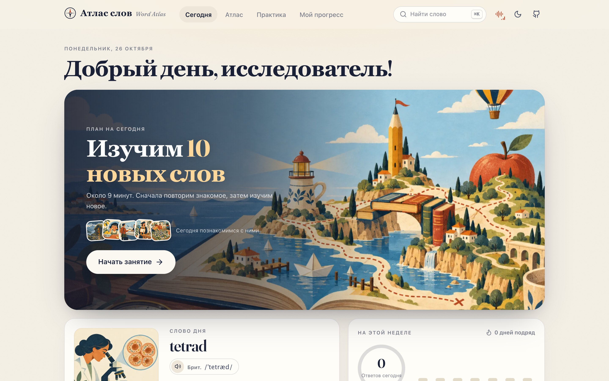
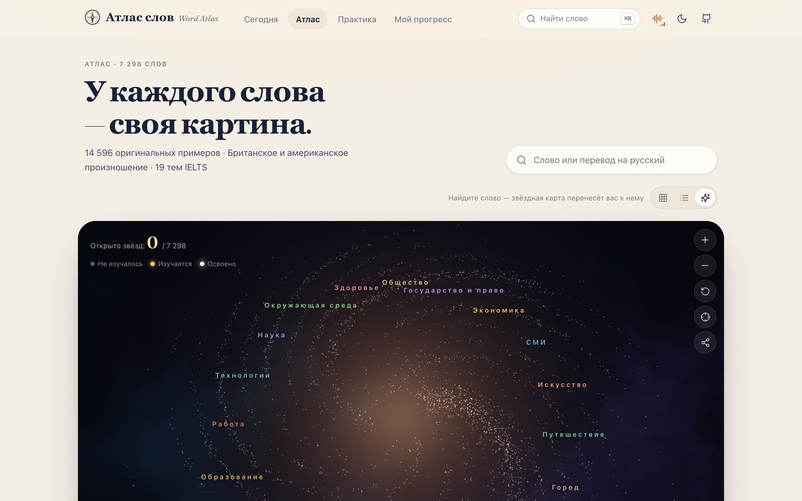
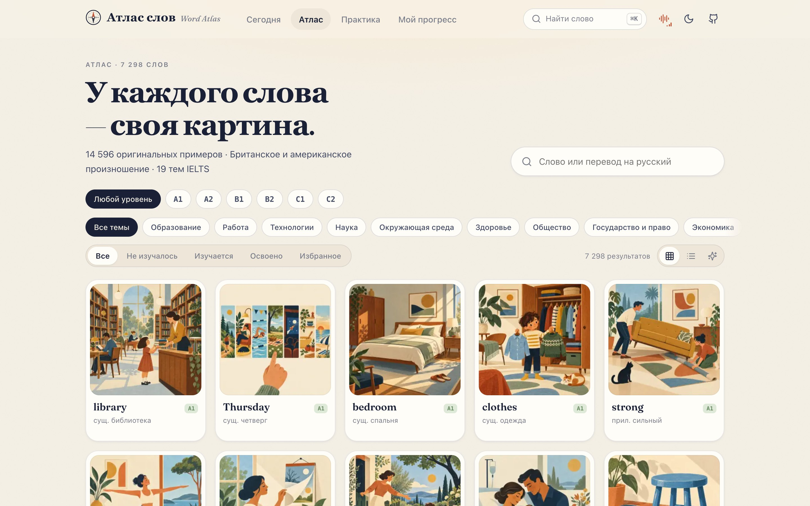
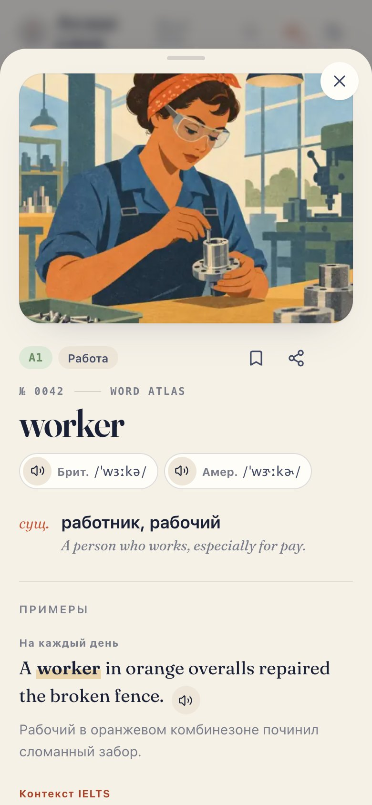

<div align="center">


# Word Atlas · Атлас слов

**Каждое слово — новая звезда.**

7298 английских слов для IELTS: русские значения, иллюстрации, примеры, британское и американское произношение, интервальное повторение.

Бесплатно, с открытым кодом, без регистрации.

[Словарь JSON и CSV](data/) · [Формат данных](docs/dataset.md) · [Обучение](docs/learning-model.md)

[Посмотреть русскую версию в действии](docs/assets/demo.mp4)
</div>

Русская версия [Word Atlas](https://github.com/designfuchen/word-atlas). Переведены интерфейс, поиск, задания, справка, значения, примеры, сочетания и подсказки. Английские учебные тексты, иллюстрации и записи произношения сохранены.

## Что внутри

| Количество | Материалы |
| ---: | --- |
| 7298 | Статей с уровнями CEFR A1–C2 и 19 темами |
| 7298 | Иллюстраций в едином стиле |
| 14 596 | Примеров с русскими переводами: бытовой и в контексте IELTS |
| 22 905 | Записей английского произношения и чтения примеров |
| 0 | Аккаунтов, рекламы и отслеживания прогресса на сервере |



## Как изучать слова

- **Посмотреть и понять.** Иллюстрация показывает ситуацию из первого примера. В статье — до трёх значений, английские определения, два примера с переводами, сочетания, однокоренные слова, синонимы, антонимы и подсказка.
- **Вспомнить самостоятельно.** Выбор значения, пропуск в предложении по картинке, узнавание на слух и написание.
- **Повторить вовремя.** FSRS назначает повторения, когда слово начинает забываться. Целевой уровень запоминания настраивается.
- **Начать со своего уровня.** Выберите стартовый CEFR и число новых слов в день. Повторения выполняются перед новыми словами.
- **Видеть честный результат.** Засчитывается первая попытка. Повторные задания на ошибочные слова не повышают точность искусственно.
- **Потренировать печать.** Написание слов, перепечатка предложений и диктант; отдельные скорость и точность без изменения памяти FSRS.

## Звёздная карта

Каждое слово — звезда. Темы образуют рукава галактики, простые слова расположены ближе к центру. Изучаемые слова светятся, освоенные становятся белыми, открытые сегодня — золотыми.

Перетаскивайте для вращения, прокручивайте для изменения масштаба, нажимайте на звезду для открытия карточки. Карта использует WebGL2; при его отсутствии предусмотрен упрощённый режим.



## Звук и удобство

- У всех слов есть британское и американское произношение и озвучка первого примера. Озвучены также 1011 вторых примеров.
- Фоновая музыка и шесть окружений: дождь, берег, лес, камин, море и кафе. Во время произношения фон становится тише.
- Русские реплики заставки и карты произносятся голосом устройства. Наличие русского голоса зависит от системы и браузера. Английские записи работают независимо от него.
- Заставка раз в день, отключаемые звуки, светлая/тёмная/системная темы, интерфейс для компьютера и телефона.
- Поиск по английским словам и русским значениям без учёта регистра и различия `е`/`ё`.
- Сохранение карточек слов, результатов занятия и звёздной карты как изображений.
- В производственной сборке просмотренные материалы кешируются для работы без сети.

<table><tr><td width="62%"></td><td></td></tr></table>

## Прогресс и резервные копии

Прогресс хранится в браузере этого устройства. В разделе «Мой прогресс» можно экспортировать копию и импортировать её на другом устройстве. Идентификаторы слов, словаря и ключи прогресса при локализации сохранены.

Сброс необратим: сначала сохраните копию. Если браузер отказывает в записи, приложение показывает предупреждение.

## Словарь для других проектов

| Файл | Содержимое |
| --- | --- |
| [word-atlas.ru.json](data/word-atlas.ru.json) | Полные русские статьи с английскими оригиналами |
| [word-atlas.ru.csv](data/word-atlas.ru.csv) | Табличный экспорт, UTF-8 с BOM |
| [data/ru/](data/ru/) | Исходные части русских переводов для пересборки |
| [word-atlas.json](data/word-atlas.json) | Исходный англо-китайский словарь, сохранён без изменений |
| `public/atlas/img/`, `thumb/` | Иллюстрации 512 px и миниатюры 256 px |
| `public/atlas/audio/uk/`, `us/`, `ex/`, `ex2/` | Английское произношение и чтение примеров |

```python
import json
with open("data/word-atlas.ru.json", encoding="utf-8") as file:
    words = json.load(file)
environment = [word for word in words if word["topic"] == "environment"]
print(environment[0]["senses"][0]["ru"])
```

Можно создавать колоды Anki, приложения, расширения и исследовательские наборы с указанием авторства. См. [формат данных](docs/dataset.md).

## Локальный запуск

Нужны Node.js 20+ и npm; для пересборки данных — Python 3.

```bash
git clone https://github.com/ivkiwi/word-atlas.git
cd word-atlas
npm ci
npm run dev
```

Откройте `http://localhost:5188`. Телефон в той же сети может использовать адрес Network из вывода Vite.

```bash
npm test
python3 -m unittest discover -s scripts/atlas -p 'test_*.py'
npm run build:atlas
npm run check:atlas
npm run build
```

`build:atlas` собирает русский JSON, CSV и данные приложения из сохранённых переводов. Он не вызывает модели или переводчики; неполный набор отклоняется до записи результатов.

`build` создаёт статический сайт в `dist/`. Для подкаталога: `ATLAS_BASE=/words/ npm run build`. Подробнее: [развёртывание](docs/deployment.md), [конвейер материалов](docs/pipeline.md), [участие](CONTRIBUTING.md).

## Откуда материалы

Автор описывает исходный список как распространённую лексику IELTS Reading; конкретный первоисточник списка не указан. Значения, английские примеры, сочетания и подсказки созданы языковой моделью по спецификации; иллюстрации — по сценам из примеров; английское аудио — в ElevenLabs (Alice и Sarah).

Русские переводы подготовлены языковыми моделями непосредственно по английским и китайским исходникам. Английские учебные слова и грамматические примеры внутри подсказок сохранены. Сервисы машинного перевода в сборке не используются.

Автоматические проверки контролируют полноту, структуру, идентификаторы, английские оригиналы, согласованность экспортов и отсутствие китайских строк в русской версии. Они не заменяют редакторскую проверку значений. Сообщайте об ошибках в Issues с `id` слова или предлагайте исправление через PR.

Это не официальный словарь IELTS; проект не связан с организаторами экзамена и не обещает определённого результата.

## Лицензии

- Код, интерфейс и техническая документация — [MIT](LICENSE).
- Словарные тексты, переводы, иллюстрации и английские записи — [CC BY 4.0](CONTENT_LICENSE.md). Авторство: `Word Atlas contributors — CC BY 4.0`; указывайте изменения.
- Fraunces — SIL Open Font License; [ts-fsrs](https://github.com/open-spaced-repetition/ts-fsrs) — MIT.

Основа: [designfuchen/word-atlas](https://github.com/designfuchen/word-atlas). Русская версия: [ivkiwi/word-atlas](https://github.com/ivkiwi/word-atlas).
